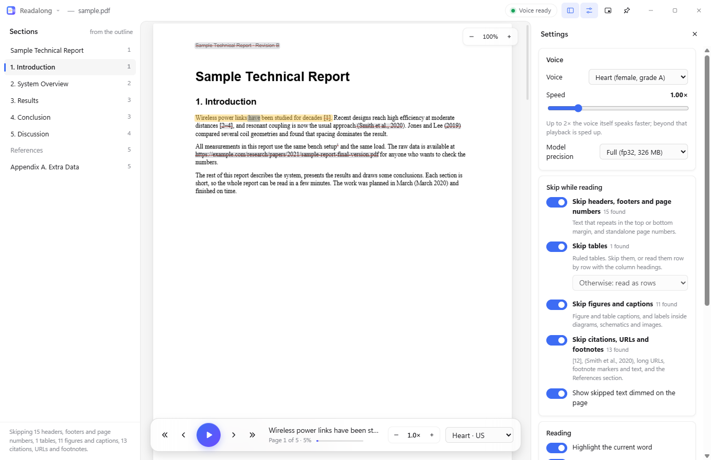
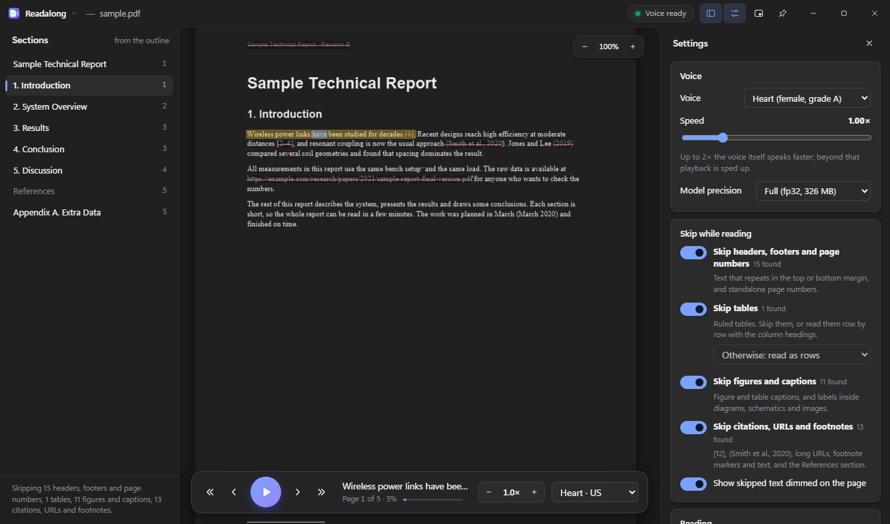
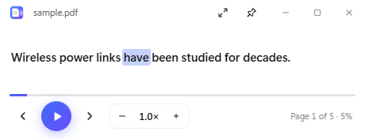

# Readalong

A Windows desktop app that reads PDFs aloud with a natural neural voice, highlighting each sentence and word as it goes. It runs entirely on your PC: the file, the layout analysis and the voice never leave it. Readalong also skips the parts you don't want read aloud, such as running headers and footers, page numbers, tables, figure labels, citations and the References section. You pick what to skip.



| Dark theme | Mini player (keep on top) |
|---|---|
|  |  |

(The repository is named `pdf-reader`. The app is called Readalong.)

## Features

- **Natural local voice:** Kokoro-82M runs on the CPU through ONNX Runtime, about 5× faster than real time on a desktop CPU. It has 28 English voices (US and UK) and speeds from 0.5× to 3×.
- **Sentence and word highlighting** on the rendered page, which scrolls to follow the voice.
- **Click any paragraph** to start reading from that point.
- **Sections sidebar**, taken from the PDF outline or, when there isn't one, from detected headings.
- **Skip options**, applied live. Skipped text is shown dimmed and struck through on the page, so you can see what will be skipped.
- **Mini player:** a small layout that keeps playing over another app while you read along elsewhere. Pin it on top with the title-bar pin or Ctrl+T.
- **Windows 11 look:** frameless window with a custom title bar, Mica background, light and dark themes that follow the system.
- **Remembers** each document's reading position, your settings, the window size and position, the on-top state and your recent files.
- **Open a PDF** by dropping it on the window, with Ctrl+O, from the recent list, or from Explorer with *Open with → Readalong*. The installer adds Readalong to Open with but never makes itself the default PDF app.

## Install

There is no published release yet. Build the installer from source (see below), then run `dist\Readalong-Setup-0.1.0.exe`. It installs for the current user, so no admin rights are needed, and adds a Start-menu shortcut. `dist\Readalong-0.1.0-portable.exe` runs without installing.

**First run:** the voice model (about 330 MB) downloads once to `%APPDATA%\Readalong\models`, with progress shown in the title bar. After that Readalong works fully offline. You can open and browse PDFs while the model downloads. Reading starts once it's ready.

## Use

| Action | How |
|---|---|
| Play / pause | Space, the play button, or **Ctrl+Alt+Space from any app** |
| Previous / next sentence | ← → (Ctrl+Alt+← → from any app) |
| Previous / next paragraph | ↑ ↓ or Shift+← → |
| Slower / faster | [ ] |
| Read from a paragraph | Click it |
| Open a PDF | Ctrl+O, drag and drop, or the menu (click the logo) |
| Mini player | Ctrl+M, or make the window small |
| Keep on top | Ctrl+T or the pin button |
| Sections / Settings | Ctrl+B / Ctrl+, |
| Zoom | Ctrl+= / Ctrl+- / Ctrl+0 |

Media keys and the Windows media overlay also control playback.

### Skip options

Each option is a toggle in Settings. Changes apply immediately, and the page shows what is being skipped. Hover over dimmed text to see why it was classified that way.

| Toggle | What it catches |
|---|---|
| Headers, footers and page numbers | Text in the top or bottom margin that repeats at the same height on several pages. Digits are normalised, so "Page 3 of 40" matches "Page 7 of 40". Also standalone page numbers ("12", "- 12 -", "Page 12", "xii") that follow the page sequence. |
| Tables | Ruled tables (full grids, or horizontal rules with shaded rows). Skip them (the default), read them **as rows** ("Row 1: Stage, TX Stage 1; Role, Impedance step-up; …"), or read the cells in order. |
| Figures and captions | Captions ("Figure 3.", "Fig. 2:", "Table 1 –", but not "Figure 3 shows…" in running text). Also text inside diagrams, schematics and images: short labels inside clusters of vector drawing objects or images, rotated labels, and scattered groups of small labels. |
| Citations, URLs and footnotes | `[12]`, `[3–5]`, `(Smith et al., 2020)`, "Smith et al. (2020)" (the year is dropped), URLs (read as the bare site name), DOIs, superscript footnote markers, small-font footnotes at the foot of the page, and the References / Bibliography / Sources section up to any Appendix. |

The detectors are conservative by design. When unsure they read the text, because silently dropping body text is worse than reading a stray label.

## Build from source

Requirements: Windows 10 or 11, Node.js 20+ (tested on 24.8), npm.

```bash
npm install
npm run dev          # run the app with hot reload
npm test             # detector, reading and timing tests (vitest)
npm run dist         # dist/Readalong-Setup-0.1.0.exe and dist/Readalong-0.1.0-portable.exe
```

Other scripts:

| Script | What it does |
|---|---|
| `npm run analyze -- file.pdf --verbose` | Print what the detectors found in a PDF, block by block |
| `npm run tts-bench` | Download the model if needed, synthesize three sentences and print the real-time factor |
| `npm run fixtures` | Write the generated test PDFs to `tests/fixtures/` |
| `npm run icons` | Render `build/icon.svg` to the PNG sizes and `build/icon.ico` |
| `npm run preview:web` | Serve the built UI in a normal browser with a fake voice, for UI work without Electron |
| `npm run typecheck` | TypeScript check |

**Test mode.** If `READALONG_TEST=1` is set (or you pass `--screenshot=<dir>`), the app never shows or focuses a window. It renders offscreen, is never on top, registers no global shortcuts and uses a separate profile (`%APPDATA%\Readalong-test`). `--screenshot=<dir> file.pdf` opens the file, runs a voice self-test, checks the window behaviour, saves `full.png` and `mini.png`, and quits. Normal launches never enter this mode.

## Architecture

```
src/
  shared/analysis/     PDF layout analysis and skip detectors (pure TypeScript, runs in the page and in Node tests)
    extract.ts         PDF.js text runs -> words; operator list -> drawings, images, rules
    layout.ts          words -> lines -> blocks (paragraphs); column-aware reading order
    tables.ts          ruled tables: full grids, and horizontal-rule / shaded-row tables
    regions.ts         clusters of vector objects and images (figures, schematics)
    detectors/         headers.ts, figures.ts, citations.ts (+ index.ts registry and skip groups)
    analyze.ts         pipeline, headings, sections (outline or headings), compact view data
    text.ts            sentence splitting with offsets, per-word clean-up for speech
  shared/reading.ts    the reading queue for the current skip settings (sentences, table rows)
  shared/tts-align.ts  word start times from Kokoro's phoneme durations; WAV encoding
  main/index.ts        Electron main: window, title-bar actions, files, recent list, menu, settings file
  main/tts-worker.ts   utility process that owns the voice model
  main/tts/engine.ts   Kokoro via kokoro-js / transformers.js / onnxruntime-node (CPU)
  preload/index.ts     the bridge exposed to the page (contextIsolation, sandboxed)
  renderer/            the UI: page view (PDF.js canvases + text layer), player, settings
tests/                 vitest suites and the pdf-lib fixture generator
build/                 icon.svg (source), icon.ico, icon.png, icons/*, installer.nsh
scripts/               analyze, tts-bench, make-fixtures, make-icons, preview-web, copy-pdfjs-assets
```

- **Analysis** runs in the window when a PDF opens. Each page is processed with PDF.js `getTextContent()` (text runs with transforms and font sizes) and `getOperatorList()` (paths and images, with the transform tracked through save/restore/transform). The output is blocks with a kind (body, heading, header, footer, page number, table, caption, figure text, footnote, references), a reason, sentences, word boxes and inline spans (citations, URLs, footnote markers).
- **Detectors** are small modules that label blocks or add spans. They never delete anything. The UI decides what to read from the labels and your settings. To add one (for example code blocks or maths), write a `Detector`, add its kinds to `SKIP_GROUP` in `model.ts`, and register it in `detectors/index.ts`.
- **Speech:** the page builds the reading queue and asks the voice process for each sentence, a few sentences ahead of the one playing, one at a time. The voice process uses the *timestamped* Kokoro ONNX export, which also returns how long each phoneme lasts. The phonemes are grouped into words, which gives each word's start time for highlighting. Clips are cached for the open document. Speed up to 2× is synthesized by the model itself; beyond that, playback is sped up.
- **Security:** the page is sandboxed with context isolation and a strict content security policy. It has no network access beyond the app itself. Links open in the default browser.

## Dependencies and licenses

The app's own code is MIT (see [LICENSE](LICENSE)).

| Component | Use | License |
|---|---|---|
| [Electron](https://www.electronjs.org/) 44 | Desktop shell | MIT (Chromium: BSD and others) |
| [PDF.js / pdfjs-dist](https://github.com/mozilla/pdf.js) | Parsing and rendering | Apache-2.0 |
| [Kokoro-82M](https://huggingface.co/hexgrad/Kokoro-82M) ([timestamped ONNX export](https://huggingface.co/onnx-community/Kokoro-82M-v1.0-ONNX-timestamped)) | Voice model, downloaded at first run | Apache-2.0 |
| [kokoro-js](https://github.com/hexgrad/kokoro) | Kokoro tokenizer, voices and pipeline | Apache-2.0 |
| [transformers.js](https://github.com/huggingface/transformers.js) | Model loading and inference | Apache-2.0 |
| [ONNX Runtime (onnxruntime-node)](https://onnxruntime.ai/) | CPU inference | MIT |
| [phonemizer.js](https://github.com/xenova/phonemizer.js) | Text to phonemes (eSpeak NG compiled to WebAssembly) | Package: Apache-2.0. **eSpeak NG inside it: GPL-3.0-or-later** |
| [sharp](https://sharp.pixelplumbing.com/) (pulled in by transformers.js) | Image utilities, not used by Readalong | Apache-2.0; bundled libvips binaries LGPL-3.0-or-later |
| pdf-lib, vitest, electron-vite, electron-builder, tsx, TypeScript (dev only) | Tests and build | MIT / Apache-2.0 |

**About eSpeak NG (GPL).** Kokoro needs phonemes, and kokoro-js gets them from eSpeak NG (GPL-3.0-or-later), compiled to WebAssembly inside the `phonemizer` package. That code is not in this repository, but the built installer includes it. If you redistribute the installer, you are distributing GPL code. You then need to meet the GPL's terms for that component (its source is at [espeak-ng/espeak-ng](https://github.com/espeak-ng/espeak-ng) and [xenova/phonemizer.js](https://github.com/xenova/phonemizer.js)), and the GPL may reach the combined work. Using it privately is unaffected. A fully permissive build would need a different phonemizer, for example misaki (MIT) with a dictionary-only fallback. That is a possible future option. This note is not legal advice.

**About sharp/libvips (LGPL).** transformers.js depends on sharp, so its libvips binaries ship in the installer unmodified, as separate DLLs. That satisfies the LGPL as long as they stay replaceable.

## Known limitations

- Unruled tables (columns aligned by spacing alone, with no lines) are read as text, not detected as tables.
- Running headers whose text changes on every page (for example the current chapter title) are only caught when the same text recurs on at least 3 pages.
- Scanned PDFs without a text layer have nothing to read (no OCR).
- Footnote detection needs smaller text below all the body text on the page. Endnotes are covered only when they sit under a References-style heading.
- Word highlighting is exact when the voice's word count matches the text. Otherwise (numbers such as "2020" spoken as several words) it is approximate within the sentence.
- English voices only. kokoro-js's phonemizer covers English.
- **Electron is pinned to 44.6.0.** On the development machine, Microsoft Defender flagged Electron 45.2.3's `ffmpeg.dll` as `Trojan:Win32/Posilod.EB!cl` and removed it. That is a cloud machine-learning heuristic: the downloaded archive matches Electron's published SHA-256, so it is most likely a false positive. Without that DLL every window's renderer crashes. Electron 44.6.0 is still a supported major version and isn't flagged. Revisit when moving to a newer Electron.
- The installer is not code-signed, so Windows SmartScreen will warn on first run.
